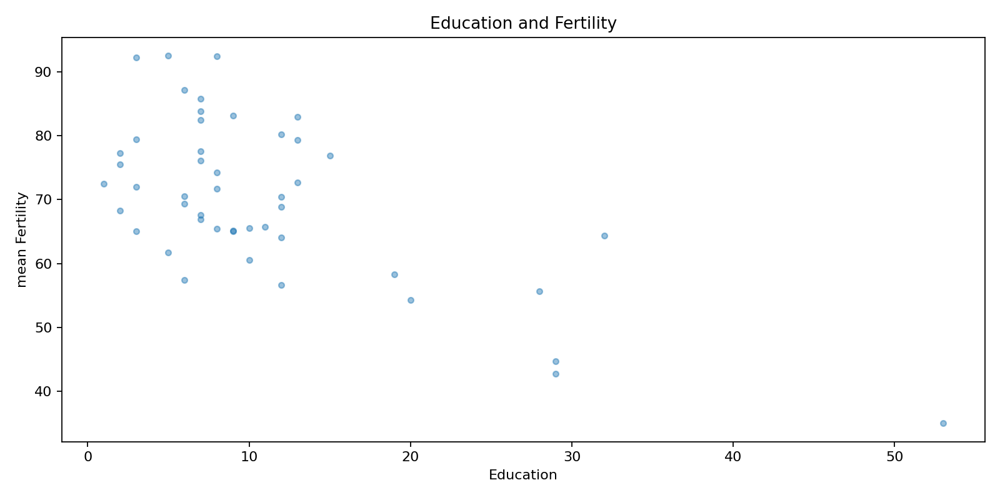

# Education and Fertility — executed results

## Decision question
How are education and fertility associated across historical regions?

## Evidence
Among 47 complete observations, Pearson r = -0.664 and Spearman rho = -0.443.

Raw rows: 47. Rows used: 47. Excluded for missing/nonfinite required values or invalid denominator: 0.

## Method
Complete-pair scatter plot of Education and Fertility, with Pearson and Spearman correlations. No regression adjustment or causal claim.

## Interpretation and limitations
Ecological 1888 Swiss data; correlation does not establish individual behaviour or causation. No causal inference, significance claim or production deployment is implied. Missing values are not imputed; identical rows are retained. Small or repeated samples limit uncertainty interpretation.

## Recommended next decision
Identify confounding and avoid policy extrapolation.

## Reproducibility
Source and exact downloaded-byte SHA256 are recorded in run_manifest.json. SQL results are in answer.csv and analysis.sqlite. Review quality_audit.csv before interpretation.
